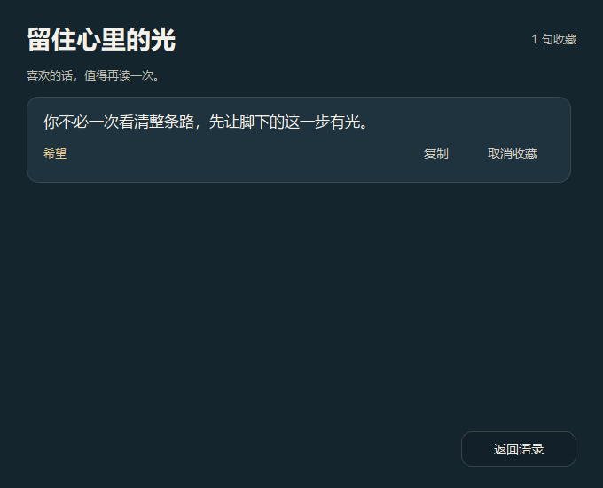

# XinGuang · Offline Chinese motivational quotes

[简体中文](README.md) · English

> 你不必一次看清整条路，先让脚下的这一步有光。

“You don’t have to see the whole road at once. Let there be light on the step you’re taking.” This line appears in the Hope collection. **The app and all 180 original quotes are in Simplified Chinese.** Press Space to turn the page, copy a line into your notes, or save it to revisit later.

**[Download XinGuang for Windows x64](https://github.com/troulierkilian-blip/xinguang-motivational-quotes/releases/latest)** · Under **Assets**, choose the ZIP ending in `windows-x64.zip`, extract it, and double-click **心光.exe**. The app runs offline without an account or Python installation. The release includes a SHA-256 checksum file.


## Read, copy and revisit

| Action | Chinese control | Shortcut |
| --- | --- | --- |
| Draw another quote and a matching landscape | 换一句 | Space |
| Copy the current quote’s text | 复制语录 | Ctrl+C |
| Save or unsave the quote | 收藏这句 | Ctrl+D |
| Open your favorites to copy a line or remove it | 我的收藏 | Ctrl+L |



The [quote collection](assets/quotes.json) covers perseverance, courage, hope, growth, focus and action. Each theme has 30 quotes and two generated landscapes. A shuffled round runs through all 180 quotes once. On each change, XinGuang selects a scene for the new quote’s theme and avoids the immediately preceding landscape.

Favorites stay on your PC in `%LOCALAPPDATA%/XinGuang/XinGuang/favorites.json`. They persist between launches and when you move the executable.

## Build and test

Use 64-bit Windows and Python 3.11. From a PowerShell prompt in the repository root, run:

```powershell
powershell -ExecutionPolicy Bypass -File .\build.ps1
```

The script prepares the environment, verifies bundled assets, runs the core tests and builds `dist/心光.exe`. To create the portable ZIP and checksums, run `.\.venv\Scripts\python.exe scripts/package_release.py`. To run the app from source after setup, use `.\.venv\Scripts\python.exe app.py`.

The release was tested on 64-bit Windows 11. Windows 10 version 1809 or later is a compatibility target. See the [verification report in Chinese](验证报告.md) for tested configurations and the [Chinese README](README.md) for packaging and test commands.

## Credits and license

The [MIT license](LICENSE) covers the project’s code and original quotes. The 12 generated landscapes ship with the app; their [image prompts](assets/image_prompts.json) are available in the source tree. Bundled dependencies retain their own licenses as listed in the [third-party notices](THIRD_PARTY_NOTICES.md). To support the project, see the [Alipay and WeChat options](README.md#支持项目).
