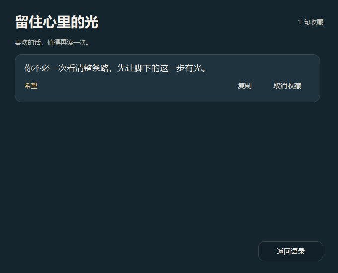

# 心光 · 离线中文激励语录

简体中文 · [English](README.en.md)

> 你不必一次看清整条路，先让脚下的这一步有光。

这是心光「希望」主题中的一句。打开这款 Windows 桌面应用，按空格，下一条语录和它的风景就会一起出现。喜欢哪一句，可以复制到笔记，或留在自己的收藏里。

**[下载 Windows x64 便携版](https://github.com/troulierkilian-blip/xinguang-motivational-quotes/releases/latest)** · 在 **Assets** 中选文件名以 `windows-x64.zip` 结尾的压缩包，解压后双击 **心光.exe**。无需安装 Python、联网或登录。下载包附中文说明，发布页附 SHA-256 校验文件。


## 翻一句，留一句

| 想做的事 | 操作 |
| --- | --- |
| 换一句，也换一幅风景 | 点 **换一句** 或按 `空格` |
| 把正文贴进笔记 | 点 **复制语录** 或按 `Ctrl+C`，再到笔记中粘贴 |
| 留住这一句 | 点 **收藏这句** 或按 `Ctrl+D`；再次操作可取消收藏 |
| 下次打开时找回来 | 点 **我的收藏** 或按 `Ctrl+L`；可以在列表里复制和取消收藏 |



[语录全文](assets/quotes.json)包含坚持、勇气、希望、成长、专注和行动六个主题，每个主题 30 句原创中文语录、两张风景。每轮随机读完 180 句，轮内不重复。切换时按主题选图，避免连续显示同一张背景。

窗口默认 1100×720，可缩放；较小屏幕会调整初始窗口。点击「换一句」时，半透明卡片和风景经过约 400 毫秒转场，连续快速点击会合并处理。

收藏保存在 `%LOCALAPPDATA%/XinGuang/XinGuang/favorites.json`，移动 EXE 后仍会保留。程序以临时文件加原子替换保存；损坏的文件会保留备份。测试模式使用独立目录。

## 开发与重复打包

需要 Windows 64 位和 Python 3.11。项目在 `.venv` 中使用固定版本的 PySide6 6.11.2 和 PyInstaller 6.22.3。

```powershell
git clone https://github.com/troulierkilian-blip/xinguang-motivational-quotes.git
cd xinguang-motivational-quotes
powershell -ExecutionPolicy Bypass -File .\build.ps1
```

该脚本会准备项目环境、验证素材、执行核心测试，再生成单文件 EXE。

生成与 Releases 相同结构的便携 ZIP：

```powershell
.\.venv\Scripts\python.exe scripts/package_release.py
```

输出位于 `dist/`。打包脚本只收集 EXE、使用说明、预览、验证报告和许可证，并验证 ZIP 内容及校验值。

```powershell
.\.venv\Scripts\python.exe app.py
.\.venv\Scripts\python.exe -m unittest discover -s tests -v
.\.venv\Scripts\python.exe app.py --smoke-test artifacts/source
```

`--smoke-test` 是维护用隔离检查，输出 JSON 报告及界面截图。Windows 默认使用原生 Qt 平台并隐藏检查窗口；隐藏窗口的动画通过推进时间轴验证结束状态。

## 项目结构

- `xinguang/catalog.py`：语录、主题与素材验证。
- `xinguang/engine.py`：随机轮次与背景选择。
- `xinguang/favorites.py`：收藏读写与损坏恢复。
- `xinguang/ui.py`：界面、动画及收藏列表。
- `assets/`：语录、主题、图标和 12 张背景。
- `assets/image_prompts.json`：通过 imagegen 技能使用内置 image_gen 生成素材时的完整提示词。
- `tests/`：语录与收藏核心测试。
- `docs/preview.png`：实际 EXE 的界面截图。
- `scripts/package_release.py`：便携 ZIP 与 SHA-256 校验文件的生成脚本。

## 兼容与验证

目标系统为 Windows 10（1809 或更新版本）/ Windows 11 64 位，参照 [Qt 6.11 官方支持范围](https://doc.qt.io/qt-6.11/windows.html)。实际检查环境及结果记录在 `验证报告.md`，未获得 Windows 10 独立环境时不会将其标为已实测。

程序不包含联网请求。版权说明见 `LICENSE` 与 `THIRD_PARTY_NOTICES.md`。

## 许可与素材

项目源码及语录采用 MIT 许可。第三方 Qt / PySide6、Python 等组件遵循各自许可，完整文本见 `assets/licenses/` 及 Windows 下载包的 `licenses/`。

12 张主题风景由内置 image_gen 工具生成，已随项目提供；生成提示词见 `assets/image_prompts.json`。背景是主题视觉素材，未作为真实地点标注。

## 支持项目

如果「心光 · 激励语录」帮到了你，欢迎通过支付宝或微信扫码打赏。感谢你的支持！

| 支付宝 | 微信 |
| :---: | :---: |
|  |  |
