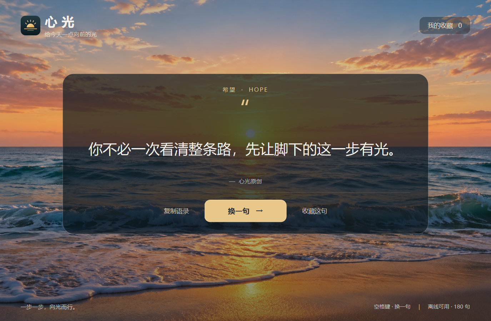

# 心光 · 激励语录

一个可以直接双击运行的离线 Windows 桌面应用。180 条原创中文语录与 12 张主题风景同步切换，提供复制、收藏和收藏列表。

**[下载 Windows 便携版 v1.0.0](https://github.com/troulierkilian-blip/xinguang-motivational-quotes/releases/download/v1.0.0/xinguang-v1.0.0-windows-x64.zip)** · [全部发布版本](https://github.com/troulierkilian-blip/xinguang-motivational-quotes/releases) · [MIT 许可](LICENSE)



## 运行

从上方下载 Windows ZIP，解压后双击 `心光.exe` 即可运行。无需安装 Python、登录账号或联网。下载包中的 `使用说明.txt` 提供详细操作说明。

GitHub 页面绿色 Code 按钮下载的是源码；直接使用软件请下载 Releases 中的 Windows 便携版。开发环境构建的 EXE 位于 `dist/心光.exe`。

| 操作 | 功能 |
| --- | --- |
| 换一句 / 空格键 | 同时更换语录与相关背景 |
| 复制语录 / Ctrl+C | 复制当前语录正文 |
| 收藏这句 / Ctrl+D | 收藏或取消收藏 |
| 我的收藏 / Ctrl+L | 查看、复制和取消已收藏的语录 |

窗口默认 1100×720，可缩放；系统屏幕较小时会调整初始窗口。界面包含半透明卡片、暖金色按钮和约 400 毫秒的转场。连续快速点击在转场结束前不会重复触发。

语录采用随机打乱的完整轮次：每轮 180 句不重复；背景通过语录主题匹配，每次更换都避免使用上一张图片。六个主题各有 30 句和两张风景。

收藏保存到 `%LOCALAPPDATA%/XinGuang/XinGuang/favorites.json`，移动 EXE 后仍会保留。程序以临时文件加原子替换保存；损坏的文件会保留备份。测试模式的收藏使用独立目录，不影响真实收藏。

下载包旁提供 `xinguang-v1.0.0-SHA256SUMS.txt`；ZIP 内也包含各文件的 `SHA256SUMS.txt`，可用于核对文件完整性。

## 开发与重复打包

需要 Windows 64 位和 Python 3.11。项目在 `.venv` 中使用固定版本的 PySide6 6.11.2 和 PyInstaller 6.22.3。

```powershell
git clone https://github.com/troulierkilian-blip/xinguang-motivational-quotes.git
cd xinguang-motivational-quotes
powershell -ExecutionPolicy Bypass -File .\build.ps1
```

该脚本会准备项目环境、验证素材、执行核心测试，再生成单文件 EXE。

生成与 Releases 相同结构的便携 ZIP：

```powershell
.\.venv\Scripts\python.exe scripts/package_release.py
```

输出位于 `dist/`。打包脚本只收集 EXE、使用说明、预览、验证报告和许可证，并验证 ZIP 内容及校验值。

```powershell
.\.venv\Scripts\python.exe app.py
.\.venv\Scripts\python.exe -m unittest discover -s tests -v
.\.venv\Scripts\python.exe app.py --smoke-test artifacts/source
```

`--smoke-test` 是维护用隔离检查，输出 JSON 报告及界面截图。Windows 默认使用原生 Qt 平台并隐藏检查窗口；隐藏窗口的动画通过推进时间轴验证结束状态。

## 项目结构

- `xinguang/catalog.py`：语录、主题与素材验证。
- `xinguang/engine.py`：随机轮次与背景选择。
- `xinguang/favorites.py`：收藏读写与损坏恢复。
- `xinguang/ui.py`：界面、动画及收藏列表。
- `assets/`：语录、主题、图标和 12 张背景。
- `assets/image_prompts.json`：通过 imagegen 技能使用内置 image_gen 生成素材时的完整提示词。
- `tests/`：语录与收藏核心测试。
- `docs/preview.png`：实际 EXE 的界面截图。
- `scripts/package_release.py`：便携 ZIP 与 SHA-256 校验文件的生成脚本。

## 兼容与验证

目标系统为 Windows 10（1809 或更新版本）/ Windows 11 64 位，参照 [Qt 6.11 官方支持范围](https://doc.qt.io/qt-6.11/windows.html)。实际检查环境及结果记录在 `验证报告.md`，未获得 Windows 10 独立环境时不会将其标为已实测。

程序不包含联网请求。版权说明见 `LICENSE` 与 `THIRD_PARTY_NOTICES.md`。

## 许可与素材

项目源码及语录采用 MIT 许可。第三方 Qt / PySide6、Python 等组件遵循各自许可，完整文本见 `assets/licenses/` 及 Windows 下载包的 `licenses/`。

12 张主题风景由内置 image_gen 工具生成，已随项目提供；生成提示词见 `assets/image_prompts.json`。背景是主题视觉素材，未作为真实地点标注。
